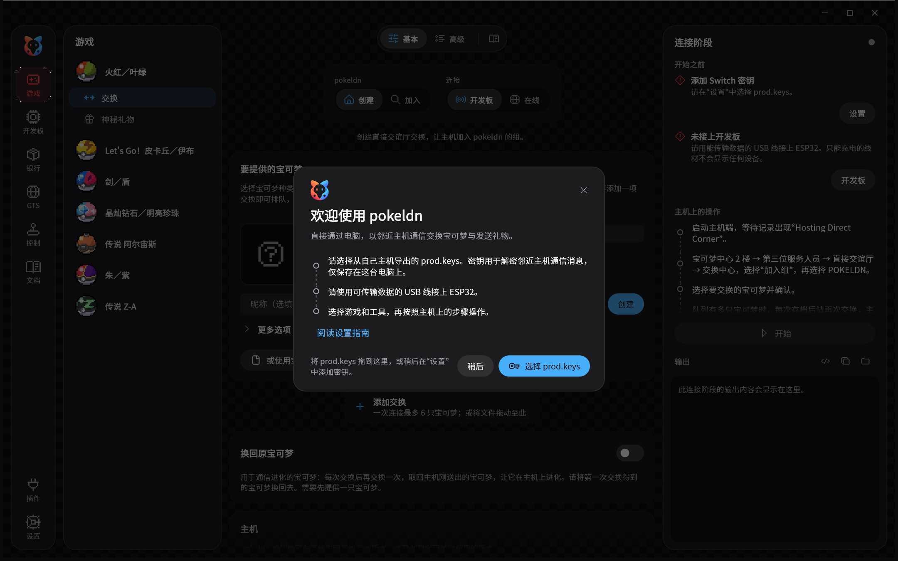

# pokeldn 简体中文语言包

[pokeldn](https://github.com/Decryptu/pokeldn) 的简体中文（`zh-Hans`）界面语言包，形态与
[繁體中文（台灣）語言包](https://github.com/jimmyorz/pokeldn-plugins-zhTW) 相同：只含数据的
`.pokeplugin`，可手动安装，也可通过 Sources 订阅更新。



## 汉化程度

| 内容 | 数量 | 状态 |
| --- | --- | --- |
| 主界面字符串 | 1,945 | 全部中文；1 条有意留空（英文复数后缀） |
| 模块消息 / 错误提示 | 1,793 | 全部中文 |
| 动态消息模板 | 68 | 全部中文 |
| 术语表 | 114 | 全部中文 |
| 工具选项说明 | 2,950 / 2,950 | 全部中文（46 个工具） |
| 应用内文档 | 15 / 49 页 | 核心手册已译；其余页面按页回退英文 |

- 与英文相同的 37 条均为有意保留：游戏简称（`FRLG`/`SV`/`SwSh`…）、`HP`/`BP`/`GTS`/`ID`、
  日期格式、纯占位符、`sudo` 命令、Showdown 样例、`Discord`/`GitHub`。
- 宝可梦、招式、道具、特性、性格、地点与合法性报告等名称不在包内，由 pokeldn 在
  `zh-Hans` 下运行时向 PKHeX 查询，因此不占翻译条目。
- 固件屏幕文字、`[done]` 行、文件名/路径、GTS 原始列表、日志等由上游按设计保留原文。

## 翻译与校对

- 以 pokeldn **英文原文**为语义基准，参考 **繁體中文（台灣）語言包**的既有译文。
- 专有名词与机制词参考 **宝可梦官方简体中文**译名（如「宝可梦」「太晶团体战」「集友圈」
  「蓝乐活」「通信进化」），并逐条对照 **PKHeX 简体中文**（`zh-Hans`）校对
  （宝可梦、招式、道具、特性、性格、奖章、合法性用词等）。
- 繁体转简体使用 OpenCC 的台湾用词表，再统一大陆软件用语（程序、文件、信息、网络、默认、
  支持、用户、界面、服务器、固件等）。
- 主字符串、模块消息、模板、术语和工具说明均经分批人工审校；标点统一为 `“”`、`…`。
- 翻译与工程流水线（种子转换、批量审校、校验脚本、打包）由 **DeepSeek** 完成，
  并由维护者做了实机验证与抽查。

## 安装

### 通过 Sources

```text
https://raw.githubusercontent.com/hgsj00/pokeldn-plugins-zh-Hans/refs/heads/main/pokeldn-source.json
```

1. **Plugins → Sources** 添加上面的地址。
2. 在 **Browse** 找到「简体中文语言包」，按 **Install**。

### 手动安装

1. 下载 `packages/pokeldn-zh-Hans-<版本>.pokeplugin`。
2. **Plugins → Add a plugin**，选择该文件并确认风险提示。
3. **完全退出 pokeldn 后重新打开**，让语言包出现在语言列表。
4. **Settings → App language** 选择「简体中文」。
5. **再次完全退出并重新打开**，应用界面语言。

> 安装或启用语言包不会自动切换语言；`App language` 只影响界面，与训练家/宝可梦的语言设置无关。

## 本地测试

不需要 Sources，用隔离数据目录直接加载语言包文件夹：

```powershell
$env:POKELDN_DATA = "$PWD\work\test-data"
$env:POKELDN_PLUGINS = "$PWD\language-pack"
& 'C:\path\to\pokeldn.exe'
```

首次启动后到 **Settings → App language** 选择「简体中文」，再次重启即可。测试记录见
[docs/validation.md](docs/validation.md)。

## 文件配置

| 路径 | 用途 |
| --- | --- |
| `language-pack/` | `plugin.toml`、5 个翻译 TOML、`docs/`、图标 |
| `packages/` | 已签名的 `.pokeplugin` |
| `translation-kit/` | 翻译工作包（JSONL + 回写契约） |
| `reference/` | 英文基准快照与上游哈希 |
| `docs/workflow.md` | 工作流与上游更新流程 |
| `docs/glossary.md` | 术语表 |
| `docs/validation.md` | 验证记录 |
| `tools/` | 校验、工作包、更新与打包工具 |

## 版本信息

| 项目 | 内容 |
| --- | --- |
| 对应 pokeldn | 0.65.2 |
| 语言包版本 | 1.0.1 |
| 作者 | DeepSeek（AI） |
| 语系 | `zh-Hans` |
| 插件 ID | `community-zh-hans` |
| Plugins API | 1.13 |
| 最低 pokeldn | 0.57.0 |
| 包文件 | `packages/pokeldn-zh-Hans-1.0.1.pokeplugin`（24 文件，368,586 字节） |
| SHA-256 | `526be83aa0840010bd8c12a0781393b16505b572a10895ec2723d7e24818718e` |
| 签名指纹 | `KLL4-P37J-BMMU-PGRS`（Ed25519） |

## 致谢

- **梁圣**：汉化自由的神
- [jimmyorz](https://github.com/jimmyorz/pokeldn-plugins-zhTW)：繁體中文（台灣）語言包，
  本包的结构与语义参考都来自它。
- [Decryptu](https://github.com/Decryptu/pokeldn)：pokeldn 本體与语言包机制。
- [kwsch](https://github.com/kwsch/PKHeX)：PKHeX 简体中文名称与术语。
- [BYVoid](https://github.com/BYVoid/OpenCC)：繁简转换词典。
- 以及众多宝可梦社区作者与测试者。

本包只是把上述公开成果搬运、整理、转换并校对成简体中文，属于“拾人牙慧”的整理工作；
真正的基础来自原作者与社区。

## 免责声明

- 本语言包由社区制作，**与任天堂、The Pokémon Company、Game Freak、Creatures、
  pokeldn 及 PKHeX 的开发者均无关联**，未获其认可或赞助。
- 宝可梦、Nintendo Switch 及相关名称与角色的商标权属于各权利人；本包不授予任何商标或
  宝可梦知识产权许可。
- 任何人可以使用、修改、再分发这些文件，但**请自行承担由此产生的全部法律责任与风险**；
  作者不对使用后果、账号风险、数据丢失或法律问题作任何担保。
- 请遵守所在地区法律及游戏服务条款；不要将本包用于商业、宣传、品牌活动或神秘礼物配信。
- 本包按“现状”提供，不附带任何明示或暗示的担保。

## 安全

语言包不含可执行代码；发布包使用 Ed25519 签名（指纹 `KLL4-P37J-BMMU-PGRS`）。
私钥保管、漏洞报告与已知边界见 [SECURITY.md](SECURITY.md)。

## 授权与来源

- 本语言包（翻译文本、脚本、文档）依 **AGPL-3.0-or-later** 提供，完整条款见 [LICENSE](LICENSE)。
- 翻译内容衍生自 pokeldn 与繁體中文（台灣）語言包，二者同为 AGPL-3.0-or-later。
- 转换使用 OpenCC 词典（Apache-2.0），未随包分发；参考 PKHeX（GPL-3.0）的简体中文术语，
  但**不复制**其名称库或代码。
- 各上游项目的授权与版权归其作者所有；本仓库只保留必要的署名与链接。
