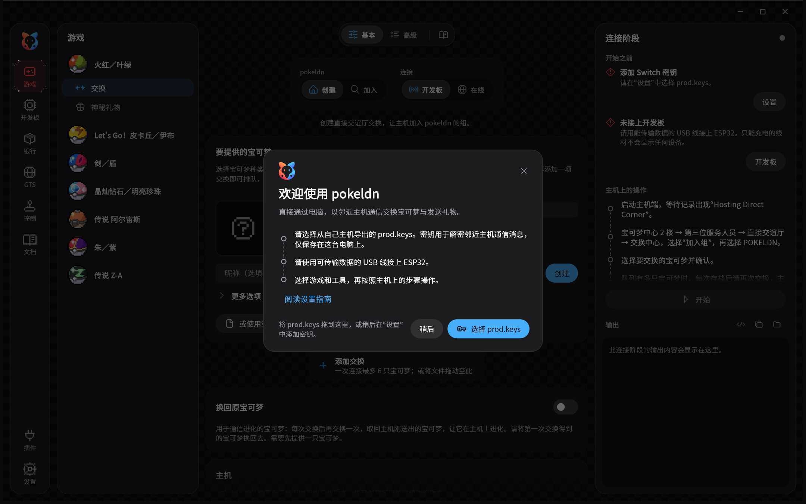

# 验证记录

本文件只记录**实际执行过**的检查。未执行的项写明“未执行”，不沿用旧版本结论。

## 当前状态（2026-11-14）

| 项目 | 结果 |
| --- | --- |
| 阶段 | 1.0.0 已签名，等待发布与 0.65.2 复测 |
| 语言包版本 | 1.0.0（已签名） |
| 基准 pokeldn | 0.65.2（`2bee2a1`），Plugins API 1.13 |
| 本地实测客户端 | 0.63.1（Windows），接受 API 1.13 |
| 英文模板 | 1,945 条；SHA-256 `93a3349a…0052` |
| 参考包 | zhTW 1.1.18（`cfb4840`） |

## 翻译完成度

| 资源 | 条目 | 状态 |
| --- | --- | --- |
| `strings.toml` | 1,945 | 1,944 条 `reviewed` + 1 条有意留空（复数后缀 `s`） |
| `messages.toml` | 1,773 | 1,772 `reviewed` + 1 条空值 |
| `templates.toml` | 68 | 68 `reviewed` |
| `terms.toml` | 114 | 114 `reviewed` |
| `help.toml` | 2,950 | 2,234 `translated` + 716 `reviewed` |
| `docs/`（应用内文档） | 15 页 | 核心手册已译；其余 34 页按页回退英文 |

- 与英文完全相同的条目 37 条：游戏简称、`HP`/`BP`/`GTS`/`ID`、日期格式 `%d %b %Y`、
  `Lv.`、纯占位符、`sudo` 命令、Showdown 样例、`Discord`/`GitHub`——均为有意保留。
- 占位符差异 **0**；残留繁体字 **0**；缺失键 **0**；工作包未知键 **0**。

## 已执行的检查

| 日期 | 检查 | 结果 |
| --- | --- | --- |
| 2026-11-14 | `scripts/extract_strings.py --check`（0.65.2） | 英文模板与源码一致 |
| 2026-11-14 | 繁中包键覆盖 | 1,945/1,945；缺失 0、多余 0、占位符差异 0 |
| 2026-11-14 | OpenCC tw2s + 129 条大陆用词替换 | strings 1,647/1,945 发生变化；残留繁体字 0 |
| 2026-11-14 | 工具选项枚举（`work/help_keys.py`，`python -O`） | 46 个工具、**2,950** 条 help，0 个工具失败 |
| 2026-11-14 | help 缺口去重 | 2,071 条缺口 = **623 条唯一英文**，分 6 批翻译 |
| 2026-11-14 | 主字符串审校 | 8 批 × 250 条，占位符全部保留 |
| 2026-11-14 | 模块消息审校 | 8 批 × 250 条 |
| 2026-11-14 | help 种子审校 | 3 批 × 240/240/236 条 |
| 2026-11-14 | 模板与术语审校 | 68 + 114 条 |
| 2026-11-14 | 标点统一（`tools/normalize_text.py`） | `「」`→`“”`、`⋯`→`…`：strings 81、messages 77、help 17 处 |
| 2026-11-14 | 组装 + `tools/validate_pack.py` | 5 个 TOML 全部写入；**OK** |
| 2026-11-14 | 加载器读取（`pokeldn.plugins._read_folder`） | id/locale/api 正确；2,950 help；`compatibility=ok` |
| 2026-11-14 | `plugins.discover()` + `i18n.select()` | 语言列表出现「简体中文」；`locale()=zh-Hans` |
| 2026-11-14 | PKHeX helper `display_language=zh-Hans` | 妙蛙种子、喷火龙、杰尼龟、阿柏蛇… 官方简中 |
| 2026-11-14 | 打包（已签名 1.0.0） | 24 文件（23 + `plugin.sig`），368,590 字节；SHA-256 `04e34198…8eae`；指纹 `KLL4-P37J-BMMU-PGRS` |
| 2026-11-14 | 已安装 0.63.1 + 隔离 `POKELDN_DATA` 启动 | 界面完整简体中文；截图见下 |

## 本地 GUI 测试（0.63.1）

环境：Windows；`POKELDN_DATA=work/test-data`、`POKELDN_PLUGINS=language-pack`；
`settings.json` 预置 `app_language=community-zh-hans`。

| 项目 | 结果 |
| --- | --- |
| 侧栏 / 工具页 / 连接阶段 / 欢迎对话框 | 全部简体中文 |
| 术语 | 「创建」「加入」「开发板」「固件」「通信进化」「集友圈」「太晶团体战」正确 |
| 字体 | `Noto Sans CJK SC`，无缺字 |
| 已知差异 | 0.63.1 的按钮 “select prod.keys” 在 0.65.2 中已改为 `main.choose_prod_keys`；该键在旧版不存在时按设计回退英文。不属于语言包缺键。 |

## 应用内文档（Docs 页面）

侧栏标题通过 `messages.toml` 翻译（新增 20 条），正文通过插件 API 1.9 的 `documents = "docs"`
按页替换：`i18n.document()` 只接管包里存在的页面，未翻译的页面继续显示英文。

| 项目 | 结果 |
| --- | --- |
| 已翻译页面 | 15：`index`、`hardware`、`hardware_adapters`、`hardware_pad`、`hardware_raspberry_pi`、`hardware_switch_keys`、`hardware_esp32`、`usage`、`gui`、`gifts`、`gift_simulated`、`online`、`architecture`、`code_signing`、`guide` |
| 结构校验（`work/check_docs.py`） | 标题数、代码围栏数、链接目标、front matter 键全部与英文原文一致，0 问题 |
| 解析验证 | `i18n.document("architecture.md")` 返回包内中文页；未译页返回英文 |
| 仍在英文 | 34 页：各游戏协议/逆向细节（`frlg_rom`、`sv_raid`、`pia` 等）与未列入核心手册的页面 |

> 插件机制本身可以覆盖全部文档；当前只翻“用户手册”范围，深度协议文档保留英文，避免把
> 逆向术语译错。需要时可把对应 `.md` 放进 `language-pack/docs/` 并重打包，无需改程序。

## 未执行 / 限制

| 项目 | 原因 | 计划 |
| --- | --- | --- |
| `scripts/check_language_pack.py`（官方） | 本机无 Python 3.13 与依赖，PyPI 被阻断 | CI（`.github/workflows/validate.yml`）执行 |
| 设置页语言下拉的视觉确认 | 系统禁止模拟输入，无法点击 | 手动检查一次 |
| `.pokeplugin` 安装向导、风险页、签名 | 私钥未定 | 发布前执行 |
| 0.65.2 客户端复测 | 本机只有 0.63.1 | 发版前复测 |

## 发布前必须补全

- [ ] Ed25519 私钥生成与指纹记录（`--key`），包内 9 文件
- [ ] `scripts/check_language_pack.py` 通过（CI）
- [ ] 全新目录安装 → 选语言 → 重启 → 界面简体
- [ ] 旧版覆盖升级保留启用状态与语言选择
- [ ] `pokeldn-source.json` 的 SHA-256、大小、图标 URL 与实际包一致
- [ ] README/CHANGELOG 版本号与日期

